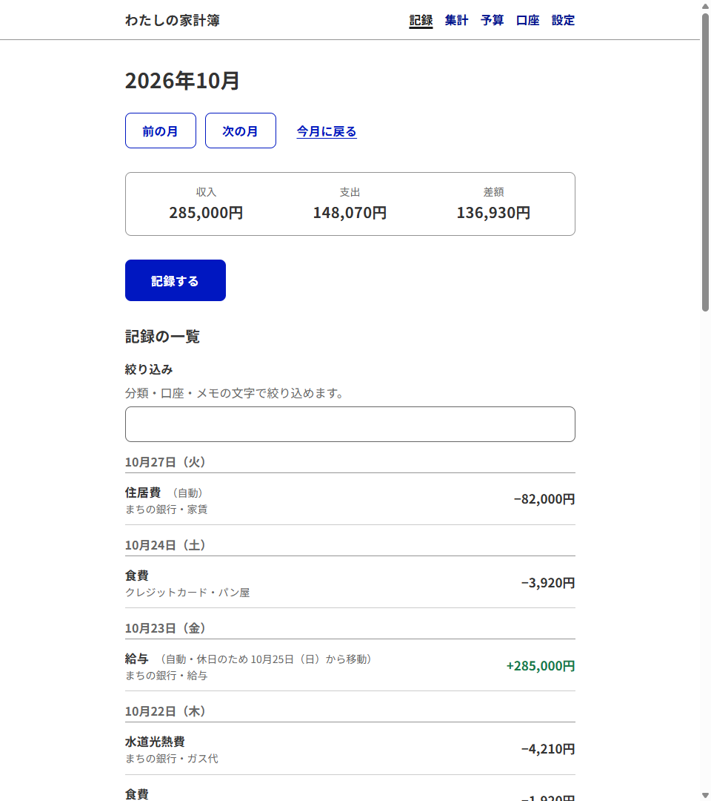
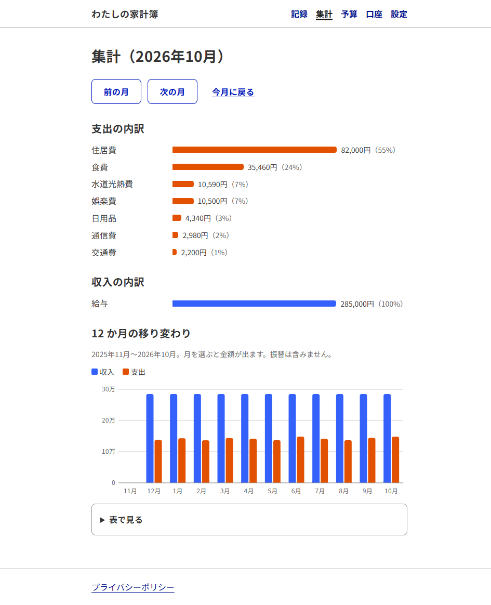
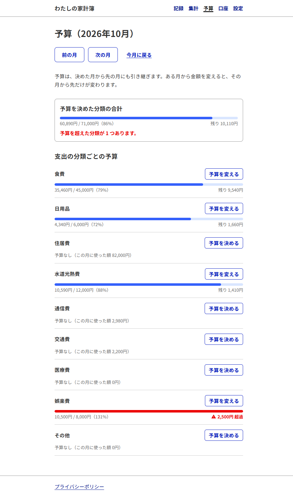
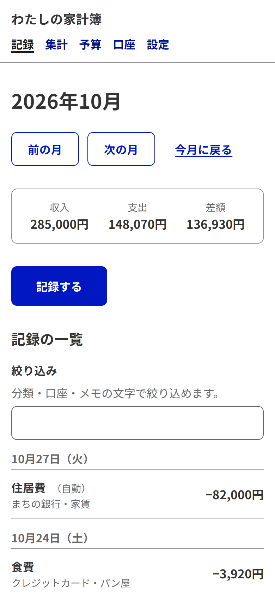
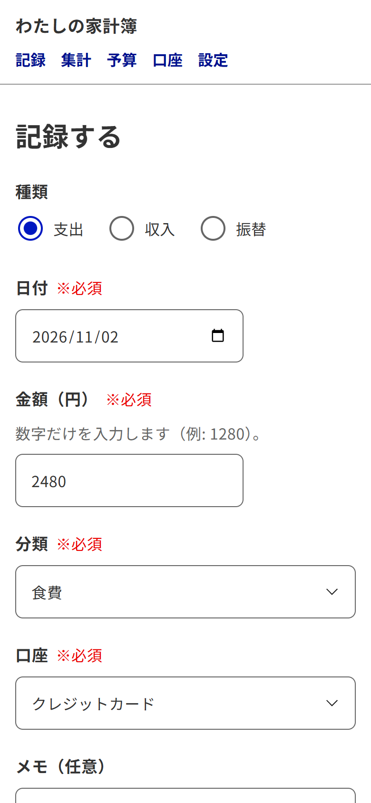

# わたしの家計簿

個人の家計を管理する Web アプリ。家計の記録はブラウザの中で暗号化してから保存し、運営する側にも中身が見えないようにする。
画面の作りはデジタル庁デザインシステム（DADS）に合わせる。

- 公開している URL: https://kakeibo-app.tsuguchi.workers.dev
- 要件: [REQUIREMENTS.md](REQUIREMENTS.md)
- データ構造と暗号化の設計: [DATA_MODEL.md](DATA_MODEL.md)
- プライバシーポリシー: [PRIVACY_POLICY.md](PRIVACY_POLICY.md)

## スクリーンショット

画面の金額やメモは、練習用の Firebase（Emulator）に入れた見本のデータです。

### 記録の一覧

月ごとの収入・支出・差額と、その月の記録。毎月の自動記録には「（自動）」と付き、休日でずらした分にはもとの日付も出る。

### 集計

その月の支出・収入の分類別の内訳と、12 か月の収入・支出の移り変わり。グラフと同じ内容を表でも確かめられる。

### 予算

分類ごとの月の予算に対する、使った額と残り。予算を超えた分類は、赤い色と「超過」の文字で示す。

### スマホ

スマホの幅でも、パソコンと同じ機能を使える。

<table>
  <tr>
    <td></td>
    <td></td>
  </tr>
  <tr>
    <td>記録の一覧</td>
    <td>記録の入力</td>
  </tr>
</table>

## 使っているもの

- React + TypeScript + Vite
- Tailwind CSS v4
- [@digital-go-jp/tailwind-theme-plugin](https://www.npmjs.com/package/@digital-go-jp/tailwind-theme-plugin) v2（DADS の配色・文字・余白・角丸・影の定義。Figma 版 2.3.0〜2.18.2 に対応）
- Noto Sans JP（DADS の標準の書体。`@fontsource/noto-sans-jp`）
- Firebase Authentication と Cloud Firestore
- [@noble/hashes](https://github.com/paulmillr/noble-hashes)（暗号化パスワードから鍵を作る Argon2id）。そのほかの暗号の処理はブラウザ標準の Web Crypto API

## 開発の始め方

Java（Firebase Emulator が使う）と Node.js が必要。

1. `npm install`
2. `.env.example` を `.env.local` にコピーする（そのままで Emulator につながる）
3. `npm run emulators` で Firebase Emulator を起動する（Emulator の管理画面は http://localhost:4000）
4. 別のターミナルで `npm run dev` を実行し、http://localhost:5173 を開く

開発中の画面の上に黄色の帯「練習用（Emulator）につないでいます」が出ていれば、練習用の Firebase につながっている。

Emulator では、確認メールは実際には送られない。Emulator の管理画面の Authentication か、
`http://localhost:9099/emulator/v1/projects/demo-kakeibo/oobCodes` に出るリンクを開くと、確認が済んだことになる。

## 本番の Firebase

- プロジェクト ID: `kakeibo-app-61efb`（Firestore は `asia-northeast1`、Spark プラン）
- 本番の接続先は `.env.production.local` に書く（Git には入らない）。値は Firebase コンソールの「プロジェクトの設定」→「マイアプリ」にある
- `npx vite --mode production` で、本番につないだ開発サーバーを起動できる
- Google・GitHub でのログインは小さな窓（ポップアップ）を使うので、VS Code の中のブラウザでは最後まで進めない。ふだんのブラウザで開く

## 公開（Cloudflare Workers）

- URL: https://kakeibo-app.tsuguchi.workers.dev
- `npm run deploy` で、本番用に組み立てて（`.env.production.local` を使う）Cloudflare に公開する
- 設定は `wrangler.jsonc`。どの URL でも index.html を返す（SPA）
- 安全のためのヘッダー（Content Security Policy など）は `public/_headers`。Firebase の新しい機能を使ってログインや通信が止まったときは、ブラウザのコンソールでブロックされた読み込み先を確かめ、ここに足す
- 公開する URL は、Firebase の Authentication の「承認済みドメイン」に登録しておく

## コマンド

- `npm run dev`: 開発サーバー
- `npm run build`: 本番用に組み立てる
- `npm run lint`: コードの点検
- `npm test`: 暗号化などのテスト（`tests/unit`）
- `npm run test:rules`: Firestore の Security Rules のテスト（`tests/rules`。Emulator を自動で起動・終了する）
- `npm run emulators`: Firebase Emulator を起動する
- `npm run deploy`: 本番用に組み立てて Cloudflare に公開する
- `npm run deploy:rules`: Security Rules とインデックスを本番に反映する
- `npm run holidays`: 内閣府の祝日の一覧から `src/lib/data/holidays.json` を作り直す

## 毎年の作業: 祝日の一覧の更新

毎月の自動記録で休日をずらすために、内閣府の「国民の祝日」の一覧をアプリに組み込んでいる。
内閣府は翌年分を例年 2 月ごろに公開するので、公開されたら `npm run holidays` を実行し、変わった `holidays.json` をコミットして公開し直す。
組み込んだ一覧より先の年は、土日と年末年始（12/31〜1/3）だけを休日として扱う。

## DADS の部品の使い方

- 部品は npm では配られていない。必要になったものだけ、公式のお手本 [design-system-example-components](https://github.com/digital-go-jp/design-system-example-components)（MIT ライセンス）から `src/components/dads/` に写して使う。
  - 今あるのは Button・Checkbox・ErrorText・Heading・Input・NotificationBanner・Radio・Select・Slot
  - 写したお手本の版: コミット `e637c68`（2026-10-21）
- 写した部品は手を加えずに使う。見た目を変えたいときは、使う側で `className` を足す。
- お手本は Tailwind CSS v3 向けに書かれている。v4 で見た目が崩れたときは、その部品だけ直し、直した理由をコメントに残す（今は Checkbox と Radio の各 1 か所）。
- お手本が使う画面幅 `desktop:`（48em 以上）は、`src/index.css` で定義している。
- ボタンを押せなくするときは、DADS の指示どおり `disabled` ではなく `aria-disabled` を使う。
- 必須の選択肢（`select`）には `required` ではなく `aria-required` を付ける。`required` だと、選ぶ前から「無効」と読み上げられるため。
- 部品の見た目と使い方は [Storybook](https://design.digital.go.jp/dads/react/) で確かめられる。
- 文字の大きさは `text-std-16N-170`（本文）のような DADS の名前を使う。色は `text-solid-gray-800`・`bg-key-900` のような DADS の色の名前を使う。
